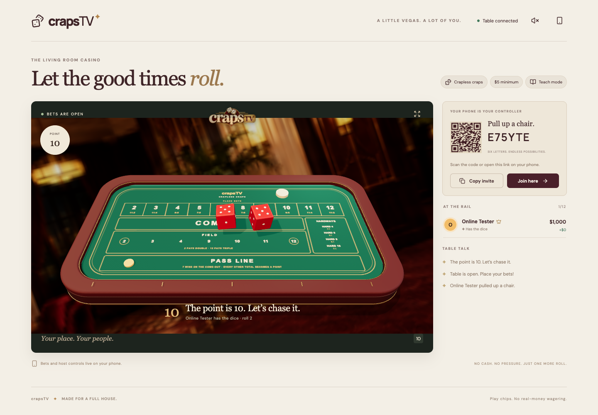

# crapsTV ✦

**Full-screen 3D craps with phone controllers.**

A personal, open-source living-room casino for 1–12 players. Built with React, Three.js, an original Blender table and dice, and a shared authoritative craps engine. Play with pretend chips on macOS, Windows, and Linux.

[**Play online**](https://tmansmann0.github.io/crapsTV/) · [Rules and architecture](docs/game-and-network.md) · [Asset provenance](docs/visual-assets.md)



## Start a local game

Install [Node.js 22 or later](https://nodejs.org/), then:

```sh
git clone https://github.com/tmansmann0/crapsTV.git
cd crapsTV
npm ci
npm run build
npm start
```

Open **`http://crapstv.local:3000`** on the TV computer or another device on the same LAN. Keep `:3000` in the URL. The root page is the full-screen 3D table; join code, QR, controls, and player balances are drawn inside the canvas. `http://localhost:3000` also works on the host computer. The terminal prints the actual local hostname and a **LAN-IP fallback**, such as `http://192.168.1.50:3000`, and phone settings can copy that fallback. The TV join card also shows the direct IP address.

The app advertises `crapstv.local` automatically with mDNS; it requires no hosts-file edits or system service installation. If another device owns the name, the app selects a distinct hostname and prints it. Joining devices need mDNS support: Windows/Android resolver behavior varies, and guest Wi-Fi, client isolation, VPNs, or multicast filtering can block discovery. If the hostname fails, use the printed LAN-IP URL or set `CRAPSTV_JOIN_MODE=ip` before starting. Set `CRAPSTV_MDNS=0` to disable discovery entirely. Allow Node through the host firewall if asked. See [local-network.md](docs/local-network.md) for platform-specific commands, hostname/interface overrides, and limitations.

These commands are the same in macOS/Linux terminals, Windows PowerShell, and Windows Terminal. No Blender, Python, model downloads, account, or cloud service is needed at runtime. Fonts, models, artwork, and audio are bundled. After installation, local sessions work offline.

`npm run dev` runs the same local server with Vite hot reload. Set the optional `PORT` environment variable to change the default port. The server listens on all interfaces so phones can connect.

## Play online with GitHub Pages

1. Open the [online game](https://tmansmann0.github.io/crapsTV/) on your TV/laptop. It opens the 3D scene and automatically hosts an online room.
2. Keep that tab open. Friends scan its QR or open [/join](https://tmansmann0.github.io/crapsTV/join), enter their name and six-character room code, and join.
3. The **first player to join** becomes the game admin. The TV itself is a spectator until someone opens **Phone controller** from Settings in a separate tab.

GitHub Pages serves the static app. PeerJS’s free public signaling service introduces the browsers; game messages then travel over WebRTC. The host browser owns the session. **Some corporate networks, symmetric NATs, or restrictive firewalls require a TURN relay; this free build does not bundle a paid relay.** If a connection cannot be made, use local play or another network. Closing/reloading the hosting tab ends the online room; it is not a persistent game server. Phone reloads can rejoin the same seat while the host remains open.

## House rules, your way

- **Classic craps or crapless craps.** Rules lock at the start; teach mode can change during play.
- **Starting stack and table minimum.** The first player chooses both.
- **Time to bet.** A 10-second betting window follows table opening and each roll. The admin can set 0–60 seconds in setup or during play. Betting stays open while the host prevents early throws.
- **Pass / don’t pass, come / don’t come, 5× true odds, place bets, field, hardways, big 6/8, and one-roll propositions.** Crapless adds 2, 3, 11, 12 as points and places, with no don’t side.
- **Teach mode starts off.** Enable it to show win probabilities, profit payouts, and house edges. The animated Learn lessons remain available, with simple explanations and local Classic/Crapless examples.
- **Visual phone controls.** Tap denomination piles into a bundle, then drag it down onto the compact betting board. A tap-and-place alternative is also available. Taking odds lives directly below Pass Line on the main board, with current stake, legal increments, remaining capacity, and quick amounts. Quick bets use the correct minimum and chip increment. If a bundle falls between legal amounts, choose the displayed lower or higher wager; nothing is silently rounded.
- **Shared 3D throws.** Swipe the phone dice upward to choose direction and strength. The TV and phone play the same server-timed trajectory; the TV follows the flight and landing. Betting locks during the throw. The authority securely randomizes the launch, simulates the dice until they settle, and reads the upper faces. Those exact physical poses remain unchanged after landing.
- **Re-up without losing your story.** With no open bets and total chips below the minimum, refill to the starting stack. Added chips count as new buy-in, never as winnings.
- **Cash out or close the table.** Unresolved wagers are returned. Each player gets a personal recap, net-result chart, biggest win, comeback count, and downloadable **1080×1440 PNG** or editable SVG.
- **Bundled announcer.** Open Settings on the TV to enable the original male Kokoro voice pack. It announces rolls, points, seven-outs, join/leave, re-ups, and other major events. Browsers require that user gesture before sound.

Place/hardway bets and come odds are **off on come-out**; traveled come bets themselves still work. Field 2 pays double and 12 triple. Proper denominations keep payouts exact. Full decisions and probabilities are documented in [game-and-network.md](docs/game-and-network.md).

## Build, test, and review

```sh
npm test                # deterministic rules and authority tests
npm run build           # portable static bundle in dist/
npx playwright install chromium
npm run test:e2e        # starts an isolated local server; TV + two phones
npm run test:odds       # isolated real-rules phone odds/layout checks
npm run test:graphics   # actual WebGL settings, calibration and persistence checks
npm run test:learn      # animated lesson rules, controls and phone fit
npm run test:payout     # board-to-bank payout presentation
npm run test:layout     # stable Play layout across interaction states
npm run test:tv         # Compact/Large layout and actual 1080p/4K glyph checks
npm run test:tour       # shared payout/camera sequence and finite idle views
npm run test:startup    # black asset gate, 30-second opening, calibration and live-room isolation
npm run test:online     # optional live PeerJS test against the published site
npm run benchmark       # isolated twelve-player WebGL frame/draw benchmark
npm run format          # format source, tests, and workflows
```

CI tests and builds on Ubuntu, Windows, and macOS. The browser test covers first-player admin, a second phone, chip bundling/drag placement, animated lessons without changing the live bank, shared swipe throws, visual roll results, a phone reload, ending the session, and a downloaded PNG. Dice/payout tests exercise both modes and wagering edge cases. Visual snapshots are saved locally to ignored `artifacts/`.

Publishing uses `.github/workflows/pages.yml`. From GitHub Actions, run **Publish crapsTV** and select the source branch; `main` also publishes after merge. Pages must be set to **GitHub Actions**. A PR can be reviewed without merging; publishing a chosen branch does not merge it.

## Inside the project

| Path                        | What lives here                                                        |
| --------------------------- | ---------------------------------------------------------------------- |
| `src/game.js`               | Deterministic rules, cents-based ledger, probabilities, recaps         |
| `src/hub.js`                | Shared room authority, private reconnect tokens, action validation     |
| `server/index.js`           | Local HTTP/WebSocket host with same-origin check and heartbeat         |
| `server/local-discovery.js` | mDNS hostname advertisement, collision handling, and LAN-IP fallback   |
| `src/transport.js`          | Local sockets or online PeerJS room transport                          |
| `src/Table3D.jsx`           | Blender models, finite HDR backdrop, cinematic shared dice playback    |
| `src/PhoneGame.jsx`         | Stable phone board, chip bundles and animated payout results           |
| `src/LearnCenter.jsx`       | Short animated lessons, examples and playback controls                 |
| `src/DiceThrow.jsx`         | 3D phone dice, aim gestures, and shared trajectory playback            |
| `src/throw-motion.js`       | Authority-generated physics timeline and stateless frame sampling      |
| `public/assets/`            | Original generated branding, vector boards, GLBs, EXR/HDR and previews |
| `assets/source/`            | Editable Blender sources                                               |
| `public/audio/`             | 51 MP3 announcements with manifests, hashes, and license notice        |
| `scripts/`                  | Optional reproducible board/model/audio generation                     |

No money changes hands. This is a casual game for friends; a human hosting a peer room controls that room’s authority. Sessions live in memory; save recap cards before stopping the local server or closing an online host. This version does not provide accounts, a lobby directory, public matchmaking, cloud saves, tournaments, hop bets, fire bets, buy/lay commission bets, or real-money gambling.

## Art and voice

The table/dice were built and exported with Blender; the boards are original editable SVGs with an open area behind the pass line for odds. The active casino environment is a real Blender-rendered **scene-linear EXR**, used for both the background and PMREM lighting/reflections. The older image-generated LDR panorama is retained as a source asset and is not used for lighting. [Model details](docs/models.md) · [Image prompts and provenance](docs/visual-assets.md).

The male voice is **Kokoro `am_michael`**. NeuTTS-2E was investigated but required gated model access, so it is not used. All 51 playable clips are bundled; see [audio.md](docs/audio.md) for the pinned model, license, and regeneration instructions.

MIT licensed original code and assets; included third-party dependencies and font/model notices retain their respective licenses. This is an independent project, unaffiliated with Jackbox or Spotify.

## Camera and TV controls

The TV page has no outer navigation, sidebar, headings, or footer. Every visible label and control is a mesh rendered within its WebGL canvas. The clipped DOM controls exist only for keyboard/screen-reader access. The top-left settings button reveals announcer, camera (**auto → table → room**), invite, controller, and fullscreen controls. Admin phones can change shared TV sound/camera settings; fullscreen applies to the device receiving the gesture. Drag to orbit and scroll/pinch to zoom. Auto view makes a slow sweep, moves in for a roll, and pauses automatic movement after manual interaction. Reduced-motion settings disable the drift and cinematic camera travel. Dice are now 0.22 table units, with recessed pips and selectable red/green/blue solid or translucent resin.

`/join?code=ABCDEF` is the dedicated phone route. The static build includes a GitHub Pages `404.html` entry and sets its base path before loading modules, so direct controller links and refreshes resolve under `/crapsTV/`. Legacy `?join=` invitations still enter the controller.

[HDR environment details](docs/environment.md).

## Detailed playing pieces and display controls

The original logo is used on the TV and the [Heritage Emerald vector felt](docs/board-design.md), developed with Claude after exploring three design directions. Hardways show pairs of dice, and the pass/don’t-pass lanes wrap around both sides of the classic layout. The active table has six front trays and three on each side, with physical chip banks and seat labels. The original table model and Blender source are preserved unchanged; the edited [twelve-seat variant](docs/player-table.md) is a separate asset. The TV settings menu starts closed. Admin controllers have shared announcer and camera settings plus invite/controller/fullscreen actions.

Chips load real modeled GLBs with edge inserts, the actual logo recessed into both medallion faces, and three independently seeded wear/roughness variants. The logo uses 2K albedo/normal maps and 1K roughness in both full and optimized geometry; the original chip models remain available. Slightly offset, supported stacks have stable per-chip tilt and yaw. A shared patina atlas varies grime, fine scuffs and burnished patches per instance while retaining the existing material batches. Preparing a phone bundle shows held chips beside that player’s bank and a ghost pile over the selected bet. Accepted stakes travel onto the felt; returned stakes and winnings travel back to the bank. Standing bets stay on the felt when only their profit is paid. Reconnecting uses the current ledger without replaying old payouts. Dice have Boolean-cut pip cavities and subtle wear maps. The current shooter can pick red, green, or blue and solid or translucent resin; choices are stored by the authority and cannot be changed mid-roll or by another player.

Cannon rigid bodies roll against the felt and the table’s raised rubber walls. The server generates unpredictable initial orientations and spin, then reads the resulting settled faces. No result is preselected and no post-landing rotation is applied. Every phone and TV samples the same recorded physical trajectory. The rubber contact boundary is X=±5.42/Z=±2.71 with a .92-unit top rail.

For the requested 3D-room illusion, the HDR image is wrapped on a finite 42-unit sphere inside the scene. Dolly/zoom therefore changes the room perspective along with the table. The same HDR still supplies PMREM reflections, but the sphere is an approximate backdrop, not a fully collision-modeled room.

[Chip sources and maps](docs/chips.md) · [Dice sources and customization](docs/dice.md)

[Phone interface and throw synchronization](docs/phone-and-throws.md).

The display now uses a [retopologized table and distance-based chip detail](docs/asset-optimization.md). Rubber-wall relief is normal mapped, compatible static meshes share material batches, and hardware rendering follows the selected 24/30/60 FPS limit. Close camera views retain the detailed logo chips. Board-local grain UVs keep darker satin wood from wrapping unnaturally around top panels and legs; matched normal and roughness maps add depth with a restrained environmental reflection.

The TV gear also opens [Graphics](docs/graphics.md): Auto/24/30/60 FPS, antialiasing, render resolution, chip detail, and 1K/2K/4K/native texture caps. A [30-second opening](docs/startup.md) starts after a black asset-loading gate, shows real modeled dice/chip action while automatic quality ramps, then reveals the room UI. Escape skips it; active games go straight to their live table. Explicit preferences persist. Admin phones can change TV graphics without touching the game ledger. **UI size** is a separate local Compact/Large choice for each TV or display.

Auto uses a wide lobby view and a close, near-top-down betting view. Throws keep one of four felt-level corner positions, then cut overhead to show the settled faces. A shared camera/chip schedule can highlight a standout result, group matching wins, or frame only the active part of the table. The camera parks before each payout starts (normally 450 ms); short windows reserve preparation time and group/compress flights within the fixed cooldown. Six macro, overhead and low flyover families use actual stack bounds, with higher, steeper views for tall stacks. Useful views finish on a held overview; idle player views do not loop endlessly. Left-drag orbits, Shift + left-drag pans, and the wheel zooms. Manual views and reduced motion take priority.

Strong direct hits can nudge or topple a few wager chips. The modeled ON/OFF puck and solid wager stacks participate in the authoritative dice simulation; the puck has a white ON face and black OFF face. See [camera and contact details](docs/roll-presentation.md), [puck model](docs/puck.md), and [betting-window rules](docs/betting-window.md).

The TV interface defaults to Compact, with an optional Large size in TV Settings for longer viewing distances. Cards sit beside their chip piles, with chip footprints reserved against overlap. The renderer supports native 1080p/4K output, independently sharp UI at reduced 3D resolution, and a 4K raster of the vector felt. See [TV display QA](docs/tv-display-qa.md).

Table finishes now use [calibrated PBR materials](docs/table-materials.md): satin walnut, textured leather, matte rubber and restrained brass, with consistent roughness and normal maps.
