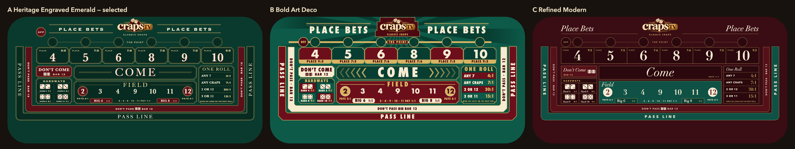
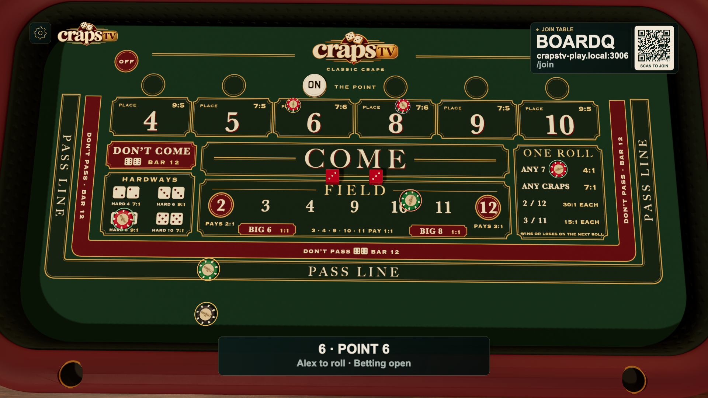
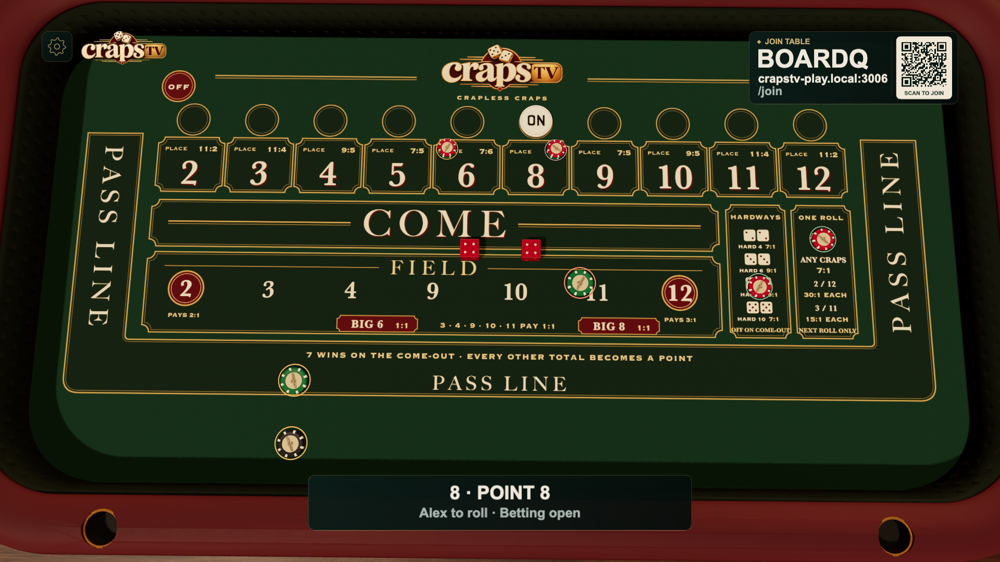
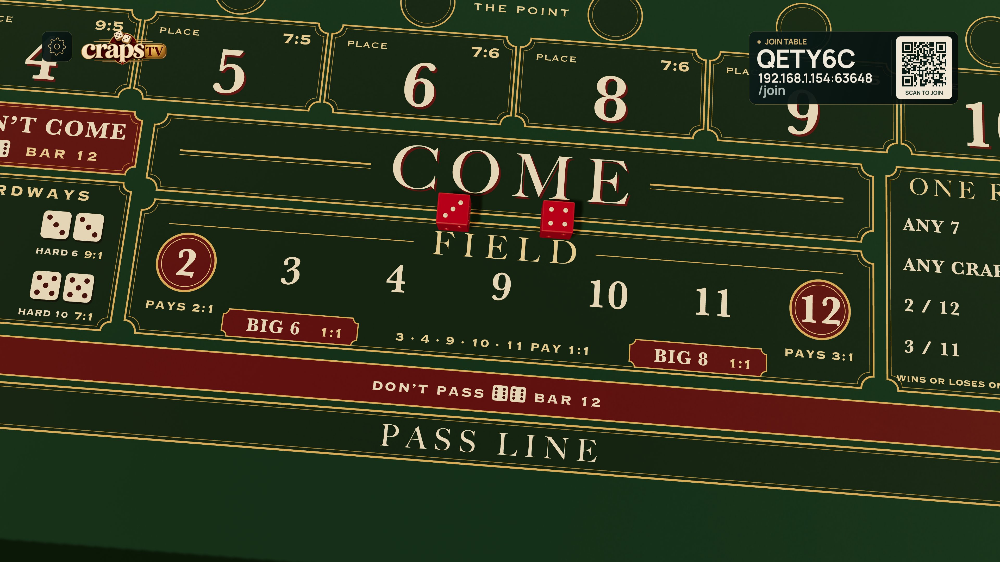

# Heritage Emerald board artwork

The classic and crapless boards are original vector artwork developed in the **new Claude Desktop chat “Craps board design directions”** on November 7, 2026. Claude drew three complete directions and then refined classic and crapless versions of the selected heritage direction. Codex reviewed the actual renders, selected A, integrated the shared coordinates, quieted the header and engraving, clarified individual proposition payouts, and exported portable production assets. No casino reference image was traced or copied. The existing crapsTV logo is the only raster element; the felt print, lettering, borders, dice pictograms and payout medallions are vectors.



A uses emerald, restrained oxblood, engraved cartouches and distinct Field endpoint payouts. B’s poster typography and sunburst competed with chips; C’s oxblood ground and hairlines were less suited to the existing table. The production version removes both large “PLACE BETS” header copies and uses explicit clipped vector engraving strokes, with preblended ink colours equivalent to 0.035 opacity. Surface fibres remain the responsibility of the table’s PBR material.

## Files and editing

| File | Purpose |
| --- | --- |
| `assets/source/board-design/heritage.mjs` | Editable vector composition for both variants; actual text, dice pips and semantic bet groups |
| `assets/source/board-design/lib.mjs` | Shared vector primitives and geometry using the runtime coordinate helper |
| `assets/source/board-design/text/board-*.svg` | Editable live-text masters, with named bet groups |
| `public/assets/board-*.svg` | Portable outlined production SVGs, with semantic region metadata |
| `public/assets/board-*.png` | Preserved historical raster exports |
| `public/assets/board-*-vector.bin` | Precompiled outlined contours for native display rendering |
| `public/assets/board-*-vector.json` | Source/binary provenance, paints and clipping metadata |
| `public/assets/board-*-minified.png` | 2048 × 1024 filtered distant-view fallback, derived without repeated hatch |
| `public/assets/board-layout.json` | Actual printed rectangles and physical anchors for every supported wager and traveled/odds alias |
| `src/board-layout.js` | Shared pure coordinate contract |

Production SVG lettering consists of glyph **paths**, so viewing or rerasterizing the checked-in exports requires no installed design fonts. The text masters retain Copperplate, Big Caslon and Baskerville with standard serif fallbacks. Full text-master regeneration should use the original authoring fonts or a deliberately reviewed replacement. No font binaries are distributed. The SVG paths are static graphic output, not an embedded reusable font.

Rerasterize the portable SVGs on any supported platform:

```sh
node scripts/render-board-textures.mjs
```

Regenerate the artwork, editable masters, glyph outlines, manifest and both PNG resolutions on an authoring machine with the fonts, Node, Playwright Chromium and Poppler’s `pdftocairo`:

```sh
python3 scripts/build-boards.py
```

The build uses Chromium to print vector artwork and Poppler to turn its glyphs into SVG paths, preserving the visual typography without copying font files. Temporary PDFs are removed. `--text-only` is available for a text-master preview; the checked-in production files use the full outline pipeline. Game startup does not run these authoring tools.

## Mapping

All wagering anchors keep their existing horizontal positions. Actual artwork pixels are:

```text
x = 1024 + (legacyX - 1024) × (1588 / 1776)
y = legacyY × 0.82 + 50
worldX = (x / 2048 - 0.5) × 10.84
worldZ = (y / 1024 - 0.5) × 5.4
```

The 50-pixel shift is **+0.263671875 world Z**. The place-number row begins at y248.44. Pass Line’s outer border ends at y836, leaving 188 pixels of real clear apron. Pass odds remain at y939.7. Big 6/8 tiles extend upward to y660 for readable type; their existing anchors stay at y693.7. Internal printed dividers are recorded from the editable SVG into the manifest, rather than inferred from label positions.

The original logo remains x879/y9/290×124 and ends at y133. The mode label ends near y150. ON targets use y204.8 (world Z −1.62); OFF uses the exact world position (−4, −2.05), approximately pixel (268.28, 123.26). The 38-pixel marker radius clears the logo. Crapless removes the central “THE POINT” caption to keep all ten puck targets clear. Corrected side labels remain +90° on the left and −90° on the right; bottom labels retain their orientation.

The shared proposition areas print **2 / 12 — 30:1 EACH** and **3 / 11 — 15:1 EACH**, matching the separate individual bets in the rules. Crapless has no Don’t Pass or Don’t Come. Hardway dice show the correct doubles, with 7:1 for 4/10 and 9:1 for 6/8.

The manifest also generates pure `BOARD_BET_REGIONS` data in `src/board-layout.js`. Physical wager positions use those actual printed bounds to constrain a fixed twelve-seat grid. Adding/removing another player never reflows an existing wager. Dense multi-player bets can overlap within a narrow cell; they are never moved into a neighboring bet to manufacture separation. Number piles retain their 0.22 diameter and classic Hardways retain 0.31. Proposition rows and crapless Hardways use 0.26172265625; Big 6/8 use approximately 0.1886328125 to fit their shallow tiles. The same diameter and position feed the visible instances and authoritative collision cylinders. Line/Pass-odds spacing remains unchanged, and pointed Don’t Pass stays on its line. The apron’s semantic region spans the full usable width, including all twelve stable odds slots.

## Verification

`tests/board-layout.test.js` checks the shift, physical anchor agreement with the runtime, full catalogue coverage, unique vector IDs, side orientations in the editable masters, and outlined production lettering. `node tests/board-design.browser.mjs` checks real browser font ink bounds, region containment, corner transparency and an undecorated flat apron. Both variants passed. Raster dimensions and the actual 2K/4K output were inspected. Final integration review also passed in the actual 3D renderer at 1920 × 1080 for classic point 6 and crapless point 8. The harness reads the rendered pile-group and chip-instance matrices, checking modeled chips exist and lie in the correct semantic region; all seven representative piles and nine chip instances matched in each view, with no browser errors. The ON puck cleared the logo and number row, and Pass Odds remained visibly below Pass. These are mapping proofs rather than a general performance benchmark.

The local exploration renders and Claude’s original rationale remain in `artifacts/board-concepts/`. The versioned comparison sheet above preserves the three explored directions; the versioned source files reproduce the final selected family.





## Native print renderer

The production renderer uses actual outlined SVG contours: 48,462 triangles for
classic and 51,428 for crapless. The source SVGs, editable text masters, layout
manifest and earlier raster exports remain unchanged. The build strips only
the repetitive decorative hatch from its derived outputs. Glyph holes, source
paint order, clips, constant-opacity masks and encoded-sRGB compositing are
preserved. Strokes are baked as non-overlapping outlines to avoid opacity seams.
The original logo retains its own source image and painter-order position.

One color-only, four-sample native ink target supplies albedo to the opaque
physical felt. It receives ordinary lighting, shadows and chip/dice occlusion.
It redraws only when the camera, mode or buffer dimensions change. The native
surface pass keeps the print independent of reduced scene resolution; material
texture settings do not downsample it. Below roughly one screen pixel per 2K
texel, a mipmapped hatch-free fallback stabilizes subpixel lines. Close cameras
use vectors exclusively. The selected B cloth shading then softens dark felt
without raised strands or fuzzy printed letters.

At 3840 × 2160 the RGBA8 resolved/MSAA targets require an estimated 158.2 MiB.
Both fallback modes after switching, the original logo and vector buffers bring
the estimated worst case to about 191 MiB. This removes the former 128 MiB CPU
8K bitmap; it is a memory tradeoff, not a universal VRAM reduction. No browser
VRAM measurement API is assumed. The target is allocated and drawn behind the
opening's black asset gate.

Rebuild derived binaries and filtered fallbacks with
`node scripts/build-board-geometry.mjs`. Run `npm run test:board`; add
`BOARD_FULL_MATRIX=1` for both antialias contexts and the native 4K matrix.
The [16-case pixel report](benchmarks/board-artwork.json) covers both rulesets,
1K/4K surface settings, 35%/50%/native scene resolution, actual ink hashes,
solid/ghost occlusion and visible macro pixels with a magenta-poisoned fallback.
The [slanted-edge measurement](benchmarks/board-edge-sharpness.json) records a
0.744-pixel 10–90% ivory-edge width in the final native 4K output. The source and
CPU review with Claude is recorded in [board resolution review](board-resolution-review.md).


