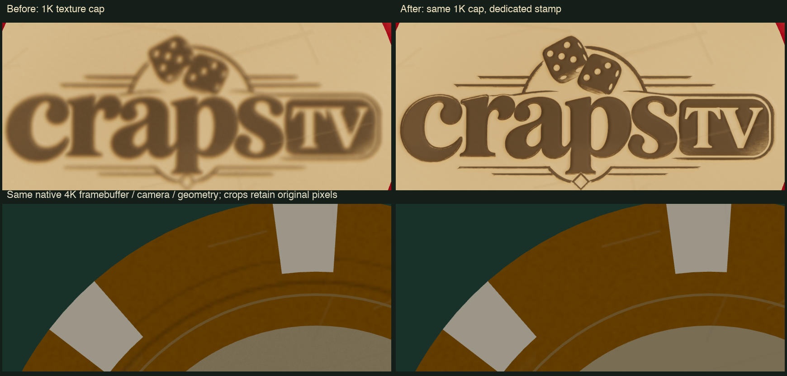

# Logo-engraved casino chips

The active models are `public/assets/chip-logo.glb` and `chip-logo-lod.glb`. They retain the beveled clay rim, eight cream edge inserts, recessed medallions and fine brass rings. Both faces now carry the **actual `brand-logo.png` artwork**: its dice, original wordmark, TV counter-shapes and decorative frame. The monochrome stamp derives from the source alpha and gold/ivory luminance; no substitute font, generic dice pits, new generated image or redrawn lettering is used.

The original `chip.glb`, `chip-lod.glb`, `assets/source/chip.blend` and `chip-lod.blend` remain byte-for-byte unchanged. The new variants have their own editable, texture-packed `.blend` sources. SHA-256 preservation records are in `public/assets/chip-logo-stats.json`.

| Active model | Triangles | Material batches | GLB bytes |
| --- | ---: | ---: | ---: |
| `chip-logo.glb` | 8,440 | 4 | 302,276 |
| `chip-logo-lod.glb` | 1,280 | 4 | 46,976 |
| Previous detailed / LOD | 10,098 / 1,984 | 4 / 4 | Original files preserved |

Shared textures remain external PNGs, referenced by content-hashed URLs, so the two model files do not embed duplicate maps. Both detail levels use the same engraving atlas. The runtime factory shares the detailed model's materials with the LOD geometry, retaining the existing instancing and projected-size hysteresis.

## Engraving and materials

The actual mark is cut **0.0032 scene units below the clay surface** in a height bake, with a rounded bevel and matched OpenGL normal/roughness maps. This is shallow surface relief; no thousands of boolean letters or fake freestanding pip geometry are required. The medallion itself remains physically recessed inside the modeled rim. Engraving relief uses the shared `ChipEngraving` material, while `ChipBase` retains denomination tint and three worn variations. `ChipInlay` remains cream and `ChipMetal` remains the brass groove ring. The common warm clay medallion keeps the mark legible across denominations.

The logo albedo and normal maps remain 2,048 × 2,048, but now use a **dedicated full-medallion UV1** shared by both faces. The earlier two-face atlas gave each wordmark only about 516 texels, or 258 under a 1K material cap. The dedicated map gives it **1,832 genuine source texels**, a 3.55× linear increase from the same 1,890-pixel-wide brand artwork. The albedo preserves the source edges without blur; rounded engraving bevels are baked separately into the normal/height. Cut depth and physical bevel width remain unchanged. Roughness stays 1K.

The original UV0 remains unchanged for patina, clay scuffs and the selected directional scratches. Only engraving primitives gain UV1; unused secondary UV buffers are stripped from other materials. Every original position/normal/UV0 triangle, its winding, bounds and material assignment matches the archived previous model. Triangle and batch counts are unchanged, with about 29 KB of shared UV data added to the high model and 712 bytes to the LOD file.

The runtime tags only the critical logo albedo and normal with `userData.minimumTextureSize = 2048`. The normal texture-quality manager still owns/registers/cleans them, but a 1K surface-texture setting retains their native 2K detail. This never upsamples a smaller source. Native GPU storage stays about 48 MiB for the shared three engraving maps; keeping these two maps sharp under a 1K surface cap costs about 32 MiB more than downsampling them. No per-chip textures or material buckets are added. The previous active atlas/models/maps are archived under `assets/source/legacy/chip-logo-d256e2d/`, with hashes; previous editable sources remain recoverable at that Git revision.

## Size and face orientation

Both models are one unit in diameter and 0.13 units thick, centered at the origin. Exported glTF uses +Y for the top face and X/Z for the horizontal plane. The Blender sources use +Z up. The detailed rim has 96 radial segments; the LOD uses 32 while preserving the same physical bounds.

The original wear atlas on UV0 remains: Blender UV front center `(0.25, 0.37)`, back center `(0.75, 0.37)`, disc radius `0.225`, side strip V `0.80..0.98`. PNG/glTF V centers are `0.63`. The back's local Y projection is reflected before export, so both logo faces read normally when the chip flips about X. This reflection corrects handedness rather than mirroring the wordmark in the texture. Normal/roughness maps use linear data; albedo uses sRGB; runtime textures retain glTF's `flipY=false` convention.

## Rebuild and proof

```sh
python scripts/build-chip-clay-detail.py
python scripts/bake-chip-logo.py
blender --background --python scripts/build-logo-chips.py
node scripts/render-chip-logo.mjs after
node scripts/render-chip-thumbnails.mjs
```

The bake requires NumPy/Pillow; geometry generation uses Blender 4.5 LTS. Shared-image GLB packaging is in `scripts/glb_shared_images.py`. Exports publish through complete temporary sibling files. The isolated Three.js proof harness uses the actual runtime factory, casino EXR and an ephemeral port with HMR disabled; it does not touch live rooms.

`docs/screenshots/chip-logo-faces.png` shows detailed chips on the left and optimized chips on the right; top row is front, bottom row is back after flipping. `chip-logo-raking.png` shows the engraved bevel under low light. The identical view with only its normal disabled is saved as `artifacts/chip-logo-after-raking-flat.png`, proving the depth is present beyond the albedo mask. Matched old/new captures and error/draw statistics are in `artifacts/chip-logo-{before,after}*`.

Focused tests verify the exact source-pixel transformation, negative height, normal slopes, both UV orientations, dimensions, shared materials, content hashes, protected original hashes and geometry budgets. Phone tray PNGs `chip-100.png` through `chip-50000.png` are regenerated from this active runtime model without allocating permanent extra WebGL contexts on phones.

## Hand-placed stacks and surface character

`src/chip-character.js` owns deterministic chip identity, pose and physical bounds. Each stack chip has a small stable offset (at most 2.7% of its diameter), a unique yaw, and sub-degree X/Z lean. Adding a chip never reshuffles the chips beneath it. Vertical spacing uses the actual tilted cylinder support height, so these imperfections do not make adjacent chip faces intersect or sink through the felt. The same visible specs produce wager-cylinder radius/height, camera bounds, screen-space label footprints and contact stacks; bank, prepared-bundle and flying-bundle construction also uses the shared pose helper.

One original procedural **1,024 × 1,024 linear patina atlas** adds handled grime, fine scuffs and burnished patches. Its R/G/B channels pack those three fields, with individual handling patches and smaller treatment over the actual logo. It changes clay colour and roughness while retaining the original albedo, engraved normals and denomination colours. The three normal-wear sets have authored base strengths 0.30, 0.38 and 0.44; the selected surface profile scales them by 2.3 and adds independent directional scratches. Original chip models and logo source remain unchanged. The current clay bake retains the original seeded grain/scars while removing circular manufacturing waves, as described below.

Per-chip UV offset and handling strength travel in each instanced mesh's existing `instanceColor` buffer slot as packed parameters. The chip shader preserves real vertex colour separately, avoiding Three.js's fragment-side instancing-colour multiplication. It uses a stable shader-cache key and one shared sampler. High/low LOD compaction repacks the parameters with the same chip IDs; moving a chip never changes its dirt pattern. Chip motion and per-instance variation never alter vertex geometry and do not create per-chip materials or extra material buckets. The patina request participates in the critical asset gate and failure cleanup.

Rebuild this technical material data with `python3 scripts/bake-chip-patina.py`. `node scripts/render-chip-character.mjs` renders the real factory, casino environment and imperfect stacks in isolated source-only Vite, with raking, overhead, macro and identical patina-disabled views. `docs/screenshots/chip-character-raking.png` and `chip-character-macro.png` are direct renderer captures. The 22-chip/six-denomination proof used 19 draws including ground, with no JS/GL errors; the material treatment changed 318,839 pixels by an average of 3.67 channel levels versus the same clean view. This is restrained wear rather than a uniformly dirty overlay. That matched comparison remains in `artifacts/chip-character-{clean,raking}.png`.

Focused checks cover sampled tilted-rim geometry bounds, supported/nonintersecting stacks, fixed poses under stack growth, every bet at all twelve seats, matching render/collision/camera envelopes, LOD/motion identity, unchanged material batching, shader colour preservation and required-atlas failure cleanup.

The final 2K front/back and full/LOD proof is `docs/screenshots/chip-logo-2k-faces.png`; the earlier 1K engraving proof remains preserved. Five native phone thumbnails were regenerated from the final material factory.


## Sharp logo and radial-band regression

The orange-chip banding had three cosmetic sources: painted guide circles in
`chip-color.png`, a circular manufacturing wave in the old clay normal/roughness
bakes, and an analytic radial grime belt in the patina shader. These are removed.
The actual molded profile and fine brass ring remain. Grime still follows each
chip's individual handling patches with the selected 0.87 dirt gain; directional
scoring, logo relief, denomination colours and per-instance wear coordinates are
preserved. No compensating dark wash was added after removing the fake belt.

Reproduce matched native 4K close views with `node scripts/render-chip-detail.mjs
after`, and the four material-isolation views with the same command plus
`--diagnostics`. Both high and LOD geometry and both face orientations are used.
The final native and general-1K-cap frames are pixel-identical on both flips:
zero changed pixels. The identical rendered wordmark crop's strongest contour
gradients rise from 9.34 to 30.30 channel levels, about 3.24×; the measurement and
frame details are in `docs/benchmarks/chip-logo-detail.json`. Actual output is
3840 × 2160, eight draws / 9,720 triangles for the two chips, without GL errors.
The before/after flat-albedo isolation proves the painted dark circles are gone
independently of lighting. These are rendering/texel proofs, not FPS guarantees.



The [upright orange high/LOD macro](screenshots/chip-detail-upright-4k.png) is a
native 4K capture with the ordinary material-texture cap set to 1K.
