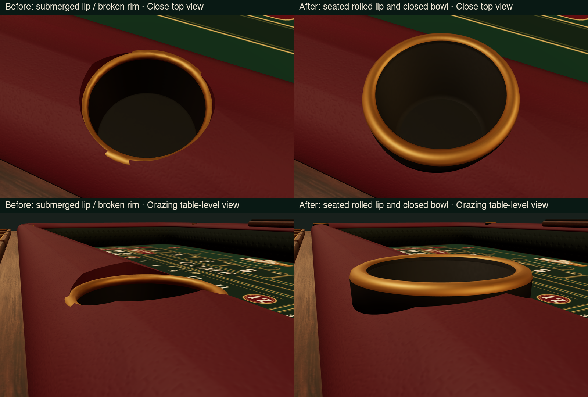

# Twelve-seat player-tray table

The display loads this new variant. The original table model and Blender source remain preserved as separate files.

## Files

- `public/assets/table-player-rails.glb` — complete table with the 12 player trays and revised sealed crown.
- `assets/source/table-player-rails.blend` — editable scene, with existing material textures packed.
- `public/assets/table-player-rails-layout.json` — exact seat, chip-stack, label, board, and collision coordinates, in glTF Y-up units.
- `public/assets/table-player-rails-preview.png` — overview QA render.
- `public/assets/table-player-rails-joint-closeup.png` — low-angle inner-crown QA render.
- `public/assets/felt-normal.png`, `felt-roughness.png` — separate seamless 512px linear-data maps for the board plane.

Build with `blender --background --python scripts/build-player-table.py`. The script reads the helper definitions in `build-models.py` without executing its original asset build, then reads the existing `table.blend`. It writes only the variant, its coordinate JSON/previews, and the requested separate felt maps.

## Seat arrangement and chip placement

The arrangement is **six front (+Z), three left (-X), and three right (+X)**. There are no back seats. Array indices in the JSON match the following order:

| Seats | Tray-center X | Tray-center Z | Bank floor Y | Tangent |
| --- | --- | --- | --- | --- |
| 0–5, front | -4.5, -2.7, -0.9, 0.9, 2.7, 4.5 | 3.91 | 0.675 | +X |
| 6–8, left | -6.59 | -1.85, 0, 1.85 | 0.675 | +Z |
| 9–11, right | 6.59 | -1.85, 0, 1.85 | 0.675 | -Z |

Each tray is 1.62×0.78 outside and 1.48×0.62 usable, with its rim at Y=0.738. Each has ten legal stack centers: five columns, separated by 0.29, in two rows separated by 0.27. The first row is 0.135 toward the table; the overflow row is 0.135 toward the player. The JSON includes every `stackSlots[].position` and the five `primaryStackPositions`, so clients need not duplicate layout formulas.

Use bank chips with diameter at most 0.23. Add half the chip's actual thickness to the floor Y before placing its center; subsequent chips rise by that thickness. Wager chips may use a different scale. `labelPosition` is just outside each tray, above the dark label plaque. Front label Z is 4.36; left/right label X is -7.04/+7.04; Y is 0.745.

## Preserved playing geometry

The board remains 10.84×5.40 at Y=0.012 with artwork mapped consistently to the new wrapped betting lanes. Dice contact faces remain X=±5.42 and Z=±2.71, with corner radius 0.86 and crown height Y=0.92. No collision change is needed for the player trays: they are outside the dice enclosure. The shelf extends the decorative footprint to X=±7.20 and Z=-3.50…4.50. Its surface is Y=0.61; do not use those outer dimensions as dice bounds.

The original crown had inconsistent corner offsets and overlapped the rubber wall near its top. The variant uses one continuous, closed padded profile around consistent corner centers. Its inside edge meets the rubber at Y=0.74, without a coplanar face overlap. The main crown and shelf each have zero boundary edges and zero non-manifold edges after their final geometry operations. Normals are recalculated after the cup booleans and vertex welding.

## Felt surface maps

Both felt textures are data, not colors. Load them in linear/no-color space and retain the printed SVG/PNG as albedo. The normal is generated from spectrally filtered periodic random fibers, and roughness varies subtly around 0.94. There is no regular weave grid or repeated diagonal motif. A physical texture repeat around one tile per 0.46 table units and a small normal scale (roughly 0.2–0.35) is a reasonable starting point. The maps are separate from the model so the same material works for classic and crapless layouts.

## Verification and preserved hashes

The overview and grazing-angle joint renders were visually inspected. The new crown shows a continuous join above the rubber, without the open wedges reported in the screenshot. The seat layout was checked for exactly 6/3/3 entries and ten stack positions per tray. The original files were SHA-256 checked before and after generation:

- `public/assets/table.glb`: `7657b4e5ee8b3070a397fc85431a966b9f36edb163ac6549b639218570f0c8a7`
- `assets/source/table.blend`: `274ea9a45126fb5156886385f895ced91770b83a67e7256809a08b40085e60d6`

The build also records these hashes and closed-mesh check results in the layout JSON and fails if the original files change during generation. No commit is created by this workflow.

## Cupholder repair

The original .865-high brass lips survived the later crown rebuild, whose leather reaches .920. Their rims therefore intersected the padding and exposed alternating brass/leather sections as the camera moved. The optimized variant now rebuilds all four inserts at their original X=±4 / Z=±3.055 positions, using continuous 96-segment profiles. The rounded brass lip reaches .942 and covers the full cutout edge. A dark mounting sleeve seats it into the curved padding; the closed bowl has explicitly inward wall faces, a rounded lower transition and a real recessed floor at .656.

`scripts/table_cupholders.py` owns these profiles; `scripts/build-optimized-table.py` installs them without passing the new surfaces through the generic decimator. Custom split normals remain continuous across material separation. Geometry is 37,852 triangles in seven material batches, within the 38,500 budget. Original table and legacy player-table GLBs/Blender sources retain their recorded hashes. Layout and game physics are unchanged.

Four focused tests decode the actual exported GLB, including node transforms. At every holder they check the entire brass annulus, inward FrontSide wall hits, complete floor hits, 2,112 nondegenerate cup triangles and the dark mounting finish. Authoring checks verify closed, manifold, positive-volume shells. Actual Three.js material/HDR renders cover forty close/high/low/orbit views without errors. Reproduce them with `node scripts/render-cupholders.mjs after`.

A short [native 4K regression sample](benchmarks/cupholders-native-4k.json) with twelve players, a physical throw, AA on, Auto chip detail and native textures recorded 360 frames in six seconds: 60.00 FPS and 16.8 ms P95 on the tested Apple M5 Pro. Scene and UI buffers both verified 3840 × 2160; no browser errors. This is device/workload evidence, not a universal frame-rate guarantee.
