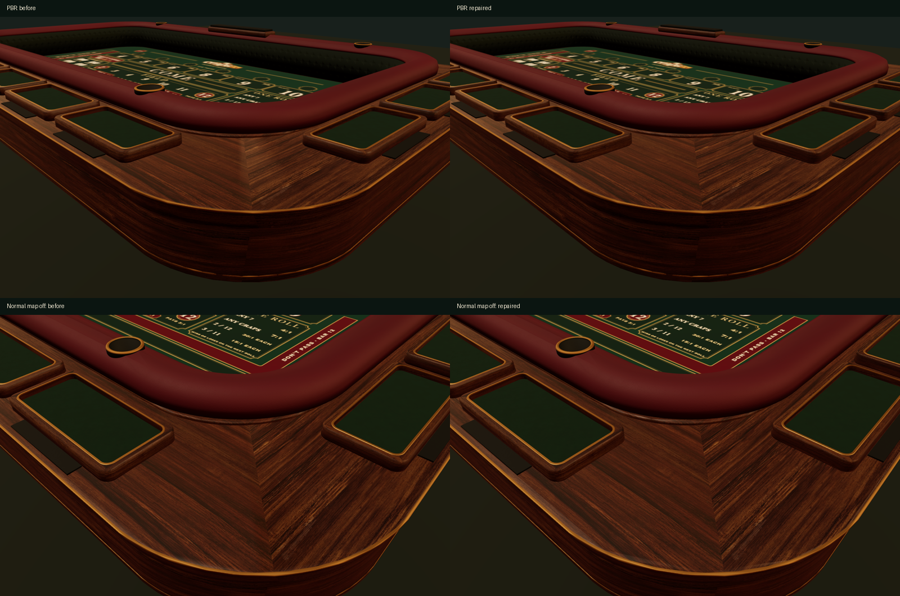
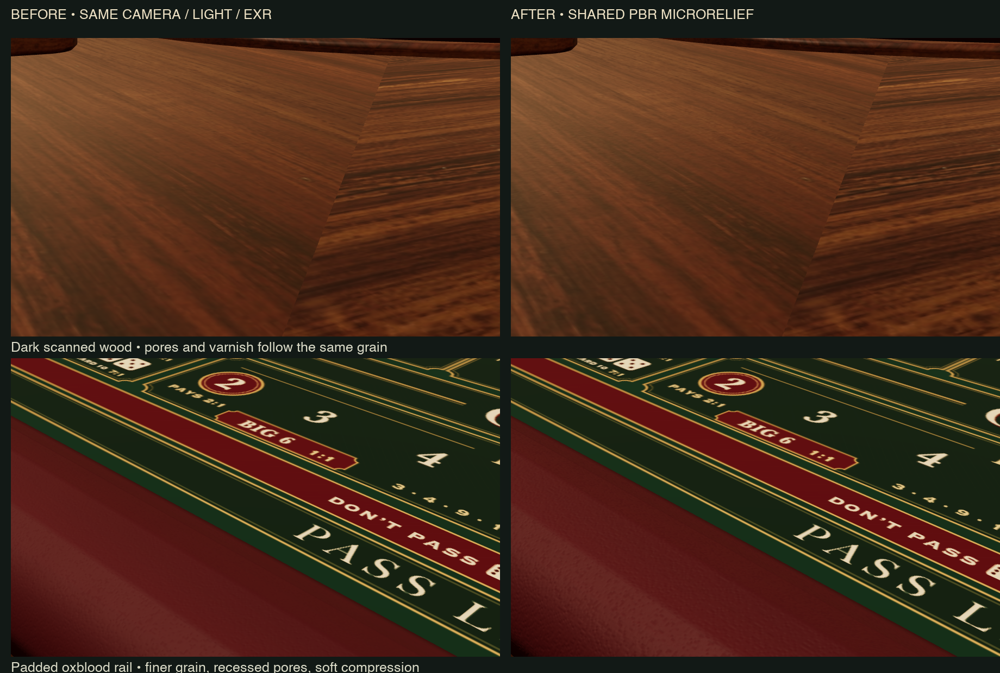
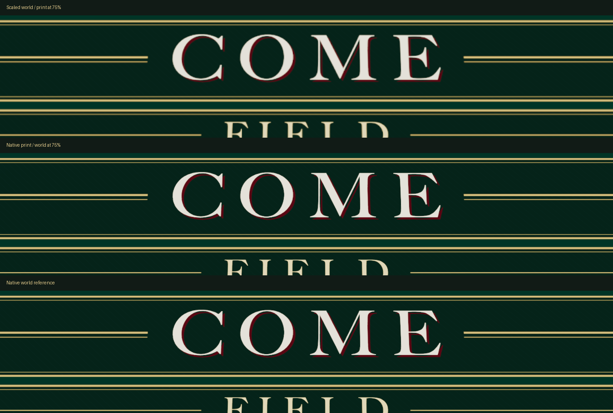

# Table surface materials

The current default is the user-selected **Clear scratches** profile (`refined`): American walnut, C felt, B red padding and the chosen chip wear. `src/table-materials.js` loads only the four American wood maps from `public/assets/wood-studies/american/`; the other candidate scans are excluded from production loading. Wood has final normal strength 0.34, roughness scalar 1, scanned pore AO at 0.24, smooth clearcoat 0.40 / roughness 0.30, environment intensity 0.85 and a 3.6-unit physical texture tile. The varnish does not reuse the substrate normal.

Padding and felt use the central `applySurfaceProfile` helper once after their authored base settings: padding normal 2.0, pore AO 0.825 and roughness contrast 1.5; baize/tray normals 2.16/1.62, sheen 0.532 and roughness contrast 1.7. Wood receives no further profile amplification. Twenty shared PBR textures remain registered with the texture-quality controller, awaited by the same startup asset gate and disposed by the table material owner. The seven geometry/material batches and all model UVs/cupholder data are unchanged.

`createTableMaterials(renderer, { surfaceProfile: false })` restores the original map selection, four-unit wood tile and unamplified base settings for A–D studies and older proof reproduction. Existing wood maps are preserved. The selected source scans, stain transforms, CC0 license and verified hashes are documented in [wood studies](wood-studies.md).

## Earlier surface iterations and preserved sources

`src/table-materials.js` applies a shared material per named surface before the table becomes visible. It loads tiling PBR textures from `public/assets/material-table-*`; `scripts/build-table-materials.py` regenerates them and writes the texture metadata/contact sheet.

Albedo images use sRGB. Normal and roughness images use no color conversion. Wood color, normal, and roughness use the same physical UV1 mapping. Leather color follows the macro UV atlas; its physical surface detail uses UV1. Wood color is a 2K JPEG; wood and padded-rail normals are real/generated 2K maps, with other surface data at most 1K lossless PNG. Its matched maps tile together every four scene units with identical U/V scale. The printed betting felt keeps its separate board artwork and fiber maps.

| Surface | Approximate effective roughness | Treatment |
| --- | --- | --- |
| Dark hardwood | 0.50 | Darker scanned grain, restrained pores, satin varnish and HDR reflections |
| Oxblood leather | 0.69 | Grain and uneven wear, very low clearcoat |
| Rubber | 0.88 | Existing baked pyramid relief, matte surface |
| Brass | 0.53 | Brushed detail and restrained metallic reflections |
| Recessed black surfaces | 0.75 | Nonmetallic matte finish |

The roughness scalar is 1 when a map already encodes the target roughness. Multiplying a 0.5 map by another 0.5 scalar creates a much glossier 0.25 surface, which was a source of the previous plastic appearance.

Playing pieces use the same principle: clay chips retain their authored roughness and reduced wear-normal strength; dice retain the resin roughness map without an extra glossy multiplier. Solid dice have less clearcoat, while glass still transmits light. Phone studio lighting is balanced so the existing red/green/blue colors remain recognizable.

All twelve chip trays use unified, shared-edge shells instead of overlapping base/rim faces. The remaining shadow speckling was separately tested with shadows off and resolved with a 0.02 normal bias. Original table and chip assets remain unchanged; the optimized table is the active variant.

The dark wood uses the matched diffuse, OpenGL normal, and roughness scans from [Poly Haven Dark Wood](https://polyhaven.com/a/dark_wood), released under [CC0](https://polyhaven.com/license). The source is photographed dark cherry/mahogany veneer, tinted toward a darker walnut-style finish; it is not claimed to be a botanical walnut scan. Originals, hashes, creators, and the transformations are recorded in `assets/source/materials/dark-wood/provenance.json`. Other surface maps are original procedural assets.

The active optimized table uses board-local UV1, authored before the seven material batches are joined. Straight front/back boards have grain along their length; end boards run across the table depth; upright trestle supports have vertical grain. The broad shelf has exact shared-edge miter boundaries. Each tray and board selects a deterministic offset within the same photograph, so the twelve trays do not repeat identical knots. Flat redundant subdivisions are dissolved without moving the silhouette. The twelve internal wood support caps underneath the closed suede beds are omitted; exterior tray walls, bottom caps, shared-edge profiles and ten-segment corner curves remain intact. UV0 and all nonwood UVs retain their previous mappings.

The stain multiplies the source RGB by `[0.70, 0.86, 0.99]`, making it slightly darker than the previous finish. The matched 2K normal uses strength `0.82`, with the same grain applied to the clearcoat normal at `0.28`; clearcoat `0.16` with roughness `0.38` gives a restrained varnish reflection, and environment intensity `0.8` uses the real casino EXR. The diffuse texture is not brightened to fake reflections. Roughness remains scan-driven with a mean near `0.50`.

Regenerate with `python scripts/build-table-materials.py`, then `blender --background --python scripts/build-optimized-table.py -- --no-preview`. The latter writes the GLB and editable Blender source through temporary sibling files and verifies hashes for the original and legacy tables. `scripts/table_wood_uv.py` owns the physical projection. Focused tests verify upright/straight grain, constant physical density on every exported wood triangle, the material settings, original asset hashes, and the 38,500-triangle/seven-batch budget. Final table geometry is 37,852 triangles in seven batches; the previous wood/tray pass used 34,508. The additional 3,344 triangles repair the four cupholder profiles, with raised rims above the .920 crown and correctly facing, closed bowls.

Actual Three.js/Metal proof uses the runtime PBR controller and casino EXR, with matched before/after camera poses: `artifacts/wood-{before,after}-{trays,corner,legs,overview}.png`. The isolated fixture adds only the printed playing plane and floor; their four triangles and two draws are excluded from table-only statistics. Run `node scripts/render-table-wood.mjs after` to reproduce these four views on an isolated ephemeral port. No live game rooms are involved.

## Optimized corner shading

The miter-seam BMesh operations could retain custom split normals from earlier topology with obsolete corner indexing. On nearly flat shelf faces this tilted some shading normals by 84.6 degrees, producing triangular highlights even with the bump map disabled. `rebuild_wood_normals` now clears stale custom data after the final topology/UV edits. True horizontal planes use face normals, while curved bevels and aprons receive fresh area/angle-weighted normals.

Actual exported-data checks inspect 1,589 horizontal wood triangles, all four deck corners, and 134 rounded outer-apron corner triangles. Horizontal normal deviation is at most 0.01644 degrees after the repair; the regression limit is 0.1 degree. Curved shared normals stay continuous. The canonical world-space wood triangle/physical-UV signature is unchanged, as are all six unlit comparison images pixel for pixel: the repair changes shading, preserving the existing geometry, grain mapping and materials. The optimized asset remains 37,852 triangles in seven material batches, with the recent cupholder profiles and protected original assets retained.

Reproduce the actual Three.js PBR/normal-disabled/unlit comparisons with `node scripts/render-corner-shading.mjs after`.

A short [native 4K regression sample](benchmarks/corner-native-4k.json) on the tested Apple M5 Pro retained approximately 60 FPS with a 16.7 ms P95 frame interval, twelve players, a physical throw, AA on and native textures. Scene/UI buffers both verified 3840 × 2160, with no browser errors. This is measured device/workload evidence rather than a universal performance guarantee.

## Close-view material depth

The wood keeps the darker albedo byte for byte, the repaired corner normals,
physical four-unit grain mapping, satin roughness and restrained environment
reflection. Its runtime normal now comes from the matched **real 2K CC0 scan**,
rather than enlarging the old 1K map. Both the wood base and thin varnish follow
the grain, so small pore highlights respond to camera motion. A subtle 1K cavity
map estimates pore recesses from that same normal using periodic high-pass
integration. This is estimated microcavity shading, not scanned displacement;
AO intensity is only 0.5 and the map averages 0.970.

The padded red rail keeps its oxblood color. A 2K tangent normal combines rounded
upholstery grain, shallow fissures, sparse tiny pores and broad soft compression.
The maximum authored relief range is less than 0.001 scene units per 0.8-unit
tile; the foam silhouette remains the closed, smooth model. Roughness follows
the grain and recessed pores (mean 0.690), with gentle pore occlusion at 0.55.
These light-dependent details add depth without making the padding glossy or
adding geometry. Baize and tray lining use the shared felt-surface settings:
short-fibre normals, roughness 1 and a soft grazing sheen, with no clearcoat.

`python3 scripts/build-table-depth.py` regenerates only wood/rail depth maps and
metadata while preserving albedos, felt maps, models and UVs. The full
`build-table-materials.py` pipeline calls this finishing bake automatically.
Source attribution/hashes and the exact transforms are recorded in the wood
provenance; `material-table-metadata.json` records resolutions and relief scales.

There are two additional shared 1K occlusion textures and two 2K normals replacing
1K maps, adding approximately 43 MiB of uncompressed mipmapped GPU texture
storage at native quality. Texture-quality controls can reduce them together.
The wood clearcoat reuses its base normal texture. Geometry and material batches
remain **37,852 triangles / seven batches**; all twelve trays share materials.
No parallax raymarch, displacement, per-player material copies or extra draw
passes were added by the depth treatment.

Matched Three.js/Metal close/raking views use the actual optimized GLB, runtime
material controller and casino EXR. Run `node scripts/render-material-depth.mjs
after` on an isolated ephemeral port to reproduce the four views in
`artifacts/material-depth-after-*.png`; the matching `before` images record the
previous material settings. Both runs produced zero browser errors, nine draws
and 37,856 triangles including the fixture's separate board/floor. Focused tests
also check aligned UV channels, shared resources, bounded roughness/AO, the real
scan hash, byte-identical dark albedos, physical felt sheen and correct cleanup.

## Dice wear and felt fibres

The dice already used three seeded scuff normal maps. Their old low-amplitude
normals, almost uniform roughness and unmarked clearcoat made handling wear
difficult to see. Three matched scratch normal/roughness pairs now affect both
the resin and coating. TV and phone use the same per-player wear selection.
Solid and translucent finishes retain their colors, carved pips and optical
behavior; the dice geometry and physics are unchanged.

The playing felt uses 1K matted short-fibre normals and nap roughness, a .46-unit
physical tile, normal strength .6 and subtle grazing sheen .28. Trays share the
same maps with gentler normal strength .45. These are lighting details rather
than displaced geometry; printed regions and bet coordinates stay fixed.
Run `python3 scripts/build-surface-maps.py` to regenerate the deterministic maps.
The Blender source generators call the same surface functions. Focused tests
decode the actual PNG normals, check bounded unit vectors, roughness variation,
tile seams and source hashes. Matched close/raking proofs can be reproduced with
`node scripts/render-dice-felt.mjs after`. The map changes add approximately
10.7 MiB of mipmapped GPU storage at native quality, subject to material caps.

The chip scuff maps were retained: clay and inlays use three normal/roughness
pairs at .30/.38/.44 relief strength, alongside the logo's own engraving normal
and per-chip patina. An actual chip-factory regression checks these assignments
through both instanced detail levels.

## Independent SVG-sourced print

Runtime artwork now loads the outlined production `board-classic.svg` and
`board-crapless.svg`, including the original logo, clipping and masks. The
browser rasterizes the active layout into one 8K atlas on capable desktop/TV
devices, or 4K on mobile, software renderers and devices reporting at most 4 GB
memory. GPU size limits still apply. This is SVG-sourced printing, not thousands
of separately rendered vector shapes. The existing semantic coordinates stay
unchanged.

This atlas is exempt from the 1K/2K/4K modeled-material texture setting. Only the
active mode owns a GPU texture; changing modes disposes the old texture and
closes its bitmap. Temporary canvases release their backing stores immediately.
An 8K RGBA mip chain is approximately 171 MiB; 4K is approximately 43 MiB. The
policy avoids keeping both 8K layouts resident together.

When the scene framebuffer differs from the native UI framebuffer, the
compositor redraws only the physical felt at native resolution. A depth-only
world pass first protects the silhouettes of chips, dice, puck and rails,
including already-composited transparent pieces. The felt retains its actual
lighting and shadow maps. At 100% scene resolution this extra pass is skipped.
Both shader variants warm while startup remains black. The float-target fallback
on unsupported hardware retains the display compositor's existing buffer limits.

`npm run test:board` self-hosts an isolated WebGL fixture. In both rulesets,
3840 × 2160 output with a 2880 × 1620 scene and a real 1K modeled wood map keeps
the print at 8192 × 4096. The native felt pixel patch matches the full-native
reference within 0.1 mean channel value, while the uncorrected scaled render
loses measurable detail. Tests also cover solid/transparent occlusion, real
shadows, mode swaps, failed SVG loads and disposal during pending decoding.
The small fixture adds four draws when the native correction is active; full
game measurements belong in the benchmark reports rather than that draw count.

Full-production, twelve-player physical-throw samples on the tested Apple M5
Pro retained approximately 60 FPS at [native 1080p](benchmarks/surface-native-1080p.json)
and [native 4K](benchmarks/surface-native-4k.json), with 16.8 ms P95 frame intervals.
The [75% scene / 1K material run](benchmarks/surface-scaled-4k.json) kept the
print/UI at native 4K and measured 59.9 FPS with 16.7 ms P95. Each twelve-second
sample verifies actual framebuffer dimensions and reports zero browser errors.
These are device/workload measurements, not a guarantee for other GPUs.

### Rounded pad geometry

The 0.12.0 crown pass also fixes the physical profile under the leather material: 21 curvature-sampled rows and analytic normals replace the old nine-point section. Material maps and the .8-unit physical detail-UV scale stay unchanged. The crown adds 2,832 triangles; the table now has 40,684 triangles in seven batches, with all six non-leather exported mesh payloads identical to the preserved previous model. See [asset optimization](asset-optimization.md#rounded-padded-crown-0120) for the 42,000 cap, archived rollback sources and actual exported-data checks.

## Choosing a stronger material treatment

The [four-way material study](https://tmansmann0.github.io/crapsTV/studies/materials/index.html) renders
Current, Enhanced, Pronounced and Bold from identical close and wide cameras.
Each 3840 × 2160 capture uses the actual Three.js table, SVG print, runtime PBR
materials, wear maps, casino lighting and 337 instanced chips. Differences are
material controls, including broader seeded chip handling stains and rubs; there
is no image-generation or image retouching. The manifest beside the images
records camera poses, settings, native framebuffer size and model hash.

The preview controller is deliberately separate from the live renderer. These
options do not change the game's default materials while a visual direction is
being selected. The Current option restores the original scalar values and
shader hooks; focused tests cover reversibility, shared resources, color bounds
and the order of patina clamping.

Run `npm run study:materials` to regenerate all eight JPEGs (set
`MATERIAL_STUDY_ANGLE` to select a graphics backend), then
`npm run test:material-study` to verify the comparison page, shot switch and
full-resolution inspector. On a local host, open
`/studies/materials/index.html`. The interactive page lets users inspect every
capture at 1:1 pixels rather than judging tiny thumbnails alone.

The revised mix preserves C's playing-felt relief, B's red padding and lighter
B-level grime. Its three scratch options add a separate shared 1K packed atlas
for directional groove normals, clay exposure and abraded roughness, including
gentler medallion hairlines. Scratch strength varies independently of dirt.
The original A–D captures remain available.

The revised wood uses a quieter [American walnut scan](https://polyhaven.com/a/american_walnut_veneer)
with matched normal, roughness and AO from Poly Haven (CC0). Candidate scans,
hashes, author credits and transformations are recorded in
`assets/source/materials/wood-studies/provenance.json`. A dark transparent stain
is applied in linear light; a smoother separate varnish fills the fine pores
rather than embossing the substrate normal into the coating. The physical
1-metre scan tile is mapped to 3.6 scene units. Geometry/UVs and the original
wood maps remain preserved. `scripts/build-wood-studies.py` regenerates three
scan candidates and `scripts/render-wood-studies.mjs` compares their actual
Three.js close/wide views. The user-facing revised mix uses American walnut
consistently, isolating the three chip-scratch strengths. Option 2 (Clear scratches) was selected and is applied at material creation in the live game.

## Selected production treatment (0.12.0)

The selected option is refined / Clear scratches: C felt, B red padding, B-level
grime, balanced directional scoring and edge rubs, and dark American walnut.
Material factories apply this treatment at creation, including later chip
denominations, player dice and phone thumbnails. They retain shared materials,
stable shader keys and instanced detail levels; there is no per-frame scene
scan or unique material per chip. The separate printed playing plane receives
the same felt treatment. A 1K scratch atlas is part of the owned, critical chip
asset gate and texture registry. Pure data maps remain linear.

The original A–D and revised study captures remain available, with explicit
factory opt-outs so comparisons reproduce their pre-selection baselines rather
than multiplying a study over the live treatment. The old wood maps and model
rollback remain preserved.

After the selected option-2 treatment was activated, chip dirt/stains were
reduced by exactly 13% through a separate .87 multiplier. The original patina
strength still drives scuffing and polish unchanged, and directional scratch
relief/exposure, felt, padding and wood values are unchanged. Revised comparisons
use the same reduction.

Production factory materials were compared with raw factories plus the approved
preview at native 4K: mean per-channel pixel differences were below 0.00015 in
both fixed shots. This also renders six denominations, three wear states,
opaque/ghost variants and both geometry levels. See
[surface-production-parity.json](benchmarks/surface-production-parity.json).
The selected production game retained approximately 60 FPS with 16.8 ms P95 in
a twelve-player, physical-throw [native-4K sample](benchmarks/selected-native-4k.json)
on the tested Apple M5 Pro, with actual 3840 × 2160 scene/UI buffers and no
browser errors. This measures one device/workload rather than all GPUs.

The matching selected-material [native-1080p sample](benchmarks/selected-native-1080p.json)
also retained approximately 60 FPS (16.8 ms P95), with twelve players, a physical
throw and verified 1920 × 1080 buffers.
